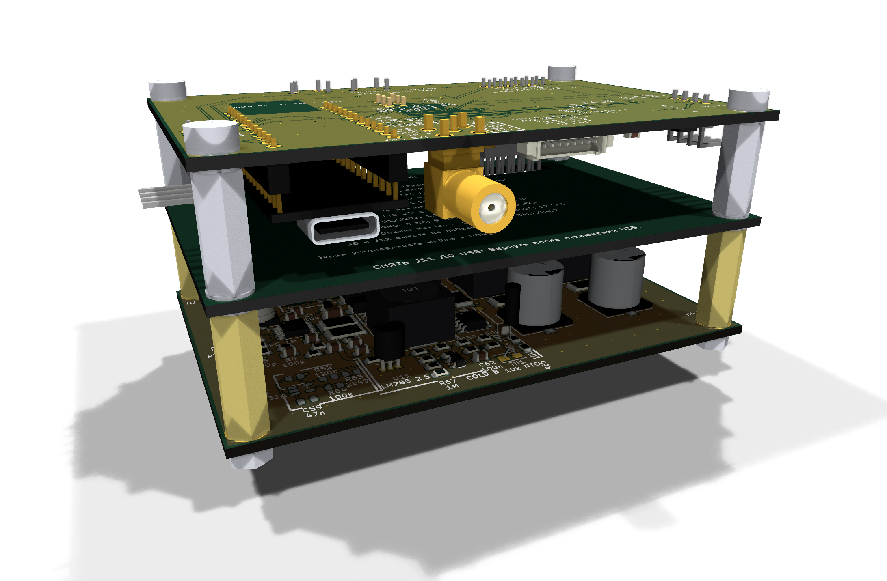
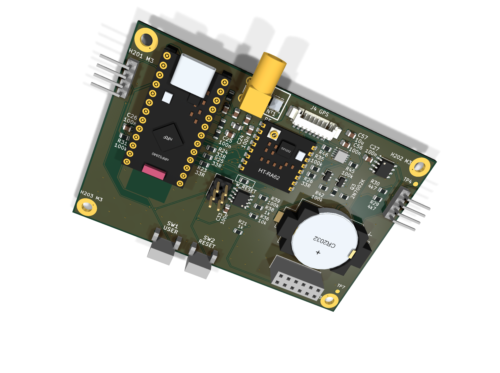
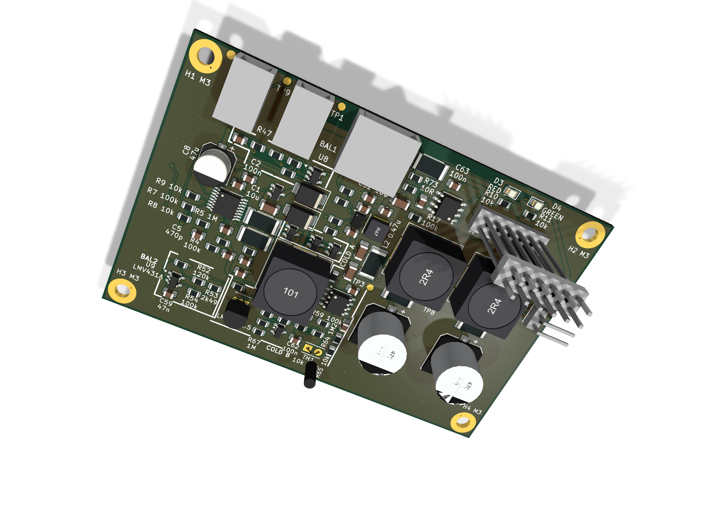
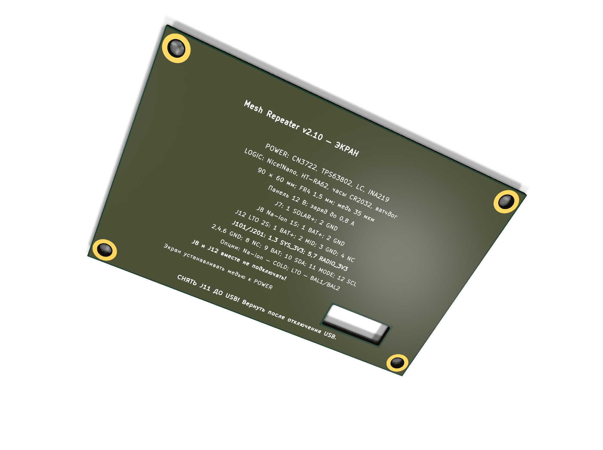
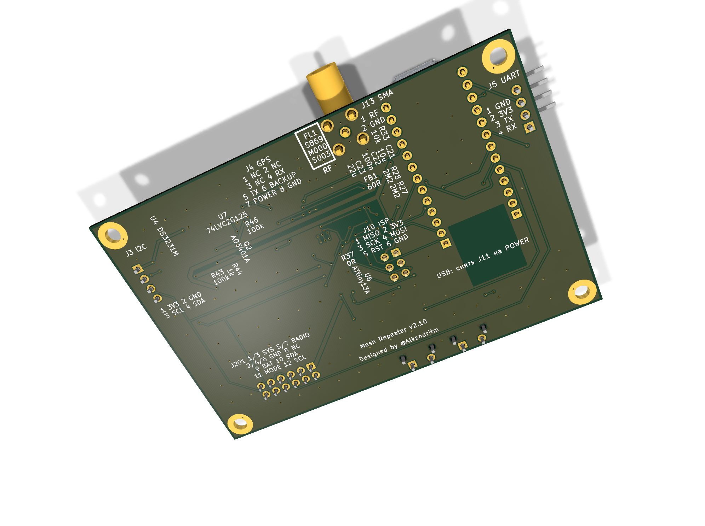
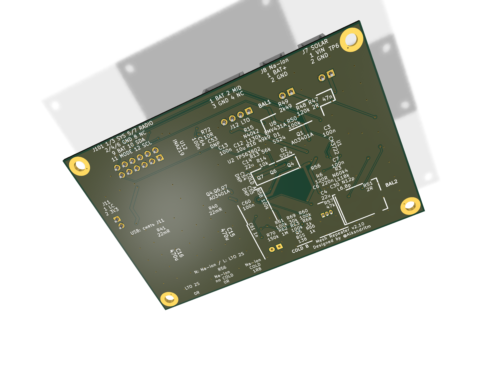

# Mesh Repeater

### Плата LoRa-репитера для MeshCore и Meshtastic

**v2.10 · POWER + LOGIC + SHIELD · 90 × 60 мм**

Солнечное питание · Na-ion 1S / LTO 2S · аппаратный watchdog

[Скачать готовый комплект](https://github.com/Alksndr55/mesh-repeater-2.0/releases/download/v2.10/Mesh_Repeater_v2.10_KiCad.zip) · [Релиз v2.10](https://github.com/Alksndr55/mesh-repeater-2.0/releases/tag/v2.10) · [Одноплатная версия v1](https://github.com/Alksndr55/mesh-repeater)

*Mesh Repeater v2.10 в сборе, вариант Na-ion 1S с COLD. Сверху LOGIC, в середине SHIELD, снизу POWER.*

Mesh Repeater v2 переносит электрическую часть ведущей версии v1 на две рабочие платы размером **90 × 60 мм**. Зарядник и преобразователь питания находятся на POWER, радиочасть и управление — на LOGIC. Между ними предусмотрена отдельная плата экрана SHIELD.

**Главные цели проекта — максимальное энергосбережение и работа в суровых сибирских зимах.**

Такое исполнение уменьшает площадь основания устройства. Межплатное соединение, стойки и крепёж описаны в проекте; исходники KiCad, перечень компонентов и материалы для сборки входят в готовый комплект.

## Что предусмотрено

| Узел | Назначение |
|---|---|
| **nRF52840 + LoRa** | Доработанный NiceNano, модуль HT-RA62 на SX1262, антенный разъём SMA и место под фильтр FL1. |
| **Солнечный зарядник** | CN3722 с настройкой рабочей точки солнечной панели. |
| **Na-ion 1S или LTO 2S** | Три варианта комплектации: Na-ion 1S с COLD, Na-ion 1S без COLD, LTO 2S с пассивной балансировкой. |
| **Питание 3,3 В** | Повышающе-понижающий TPS63802, двухступенчатый LC-фильтр и отдельная ветвь питания радиомодуля. |
| **Контроль аккумулятора** | INA219 измеряет напряжение и ток в основном тракте аккумулятора. |
| **Часы и watchdog** | DS3231M с резервом от CR2032; ATtiny13A следит за активностью TXEN и может сбросить основной процессор. |
| **Подключение и обслуживание** | Разъём внешнего GPS, I²C и UART с логикой 3,3 В, AVR ISP, кнопки USER/RESET и контрольные точки. |

## Три платы одного комплекта

| Плата | Что на ней |
|---|---|
| **POWER** | Заряд аккумулятора, COLD или балансиры LTO, преобразователь 3,3 В и LC-фильтр. |
| **LOGIC** | NiceNano, LoRa-модуль, часы, watchdog и интерфейсы. |
| **SHIELD** | Промежуточная плата экрана с GND-плоскостью и окном межплатного соединителя. |

<strong>Отдельные платы и виды с двух сторон</strong>

| LOGIC — связь и управление | POWER — заряд и питание |
|:---:|:---:|
|  |  |

*3D-рендеры отдельных плат со стороны компонентов. Комплектацию для выбранного варианта определяет BOM.*

| LOGIC — обратная сторона | POWER — обратная сторона |
|:---:|:---:|
|  |  |

В собранном устройстве LOGIC обращена компонентами вниз. Используется заданная пара межплатных разъёмов; обычная незеркальная розетка не является заменой J201. Размеры стоек и порядок сборки приведены в [описании механики](v2/docs/MECHANICS_RU.md).

### Опциональный фильтр антенны

На LOGIC предусмотрено место **FL1** для полосового SAW-фильтра **S869M000S003**. Он ослабляет внеполосные сигналы. В полосе 868–870 МГц паспортные потери составляют до 2,5 дБ. Штатный тракт проходит через медную перемычку **NT1**. Перед монтажом FL1 перемычку разрезают по инструкции и ограничивают мощность на входе фильтра до **+13 дБм**.

Рабочая температура этого фильтра **−10…+65 °C**. Для более холодных установок сохраняют штатный обход NT1. [Паспорт фильтра](https://abracon.com/datasheets/AEL-Crystals/PN/S869M000S003.pdf) · [Монтаж FL1](docs/ASSEMBLY_COMMON_RU.md)

## Совместимость с MeshCore и Meshtastic

Радиомодуль HT-RA62 (SX1262 с TCXO) подключён по распиновке **FakeTec / ProMicro nRF52840**. Для обеих версий платы подходят следующие профили прошивок.

| Прошивка | Профиль | Конфигурация |
|---|---|---|
| **MeshCore** | ProMicro nRF52840, сборка `ProMicro_repeater` | [MeshCore ProMicro](https://github.com/meshcore-dev/MeshCore/blob/repeater-v1.18.0/variants/promicro/platformio.ini#L40-L53) |
| **Meshtastic** | NRF52 Pro-micro DIY с TCXO, сборка `nrf52_promicro_diy_tcxo` | [Meshtastic ProMicro TCXO](https://github.com/meshtastic/firmware/blob/v2.7.26.54e0d8d/variants/nrf52840/diy/nrf52_promicro_diy_tcxo/platformio.ini) |

Совместимость проверена по распиновке и конфигурациям сборок. Показания напряжения аккумулятора калибруют под делитель платы **1:2**. Для Na-ion 1S и LTO 2S шкалу процента заряда адаптируют под химию и число ячеек. При подключении внешнего UART к J5 сверяют назначение RX и TX с выбранной прошивкой.

## Варианты сборки

| Вариант | Комплектация |
|---|---|
| **Na-ion 1S · COLD** | Узел температурного ограничения зарядного тока установлен. |
| **Na-ion 1S · без COLD** | Сборка без узла COLD. |
| **LTO · 2S** | Две последовательные ячейки LTO и пассивные балансиры. |

Вариант задаётся номиналами и составом деталей по BOM. Это выбор при сборке, а не переключение химии аккумулятора одной перемычкой. Условия заряда выбирают по паспорту конкретных ячеек; схема LTO не заменяет полноценную BMS.

### COLD — ограничение тока заряда на холоде

В сборке Na-ion 1S с COLD датчик TH1 на POWER задаёт температурный режим солнечного зарядника CN3722. При охлаждении схема включает дополнительный шунт R56 в цепь измерения тока. Расчётный предел зарядного тока снижается примерно с **0,67 А до 0,10 А**. При потеплении возвращается обычный режим.

Расчётный порог снижения тока — **−17,4 °C**, возврата — **−14,5 °C**. Разница между порогами помогает избежать частых переключений при колебаниях температуры. Один датчик TH1 устанавливают на плате или выносят к аккумулятору. Допустимый ток и температуру заряда сверяют с паспортом конкретной ячейки. [Общая инструкция по сборке](docs/ASSEMBLY_COMMON_RU.md)

### Watchdog — автоматический перезапуск репитера

Отдельный ATtiny13A на LOGIC с прошивкой watchdog v1.00 следит за сигналом **TXEN**, который показывает включение передатчика LoRa. Каждое новое включение передатчика запускает отсчёт заново. Между событиями контроллер спит в режиме Power-down. Когда время ожидания истекает, ATtiny13A подаёт импульс RESET на nRF52840. После сброса выбранная прошивка загружается заново и инициализирует радиомодуль.

При 3,3 В и комнатной температуре расчётные ориентиры составляют около **3,5 часа** ожидания и **1,2 секунды** сброса. При длительном молчании радиомодуля или застрявшем высоком TXEN тайм-аут тоже срабатывает. [Подключение и прошивка watchdog](v2/design/watchdog_reference/INTEGRATION_RU.txt)

## От схемы — к детали на плате

В ZIP уже включён **portable NexusBV**. Запуск `START.cmd` открывает меню с CAD и PDF-схемой нужной платы и сборки. Двойной щелчок по обозначению или свободной части тела символа в PDF помогает найти компонент на бордвью.

- Шесть CAD: по **NaIon_COLD** и **LTO_2S** для POWER, LOGIC и SHIELD, с номиналами и DNP. Для SHIELD открывается только CAD.
- PDF-схемы, BOM, инструкции по электрической и механической сборке.
- Проекты KiCad 10 с локальными посадочными местами и всеми используемыми 3D-моделями.
- Watchdog v1.00: исходники, HEX и инструкция прошивки.

## С чего начать

1. Скачайте **Mesh_Repeater_v2.10_KiCad.zip** из [релиза](https://github.com/Alksndr55/mesh-repeater-2.0/releases/tag/v2.10) и полностью распакуйте его.
2. Для просмотра запустите `START.cmd` в Windows; для редактирования откройте [POWER](v2/design/MeshRepeater2_Power/MeshRepeater2_Power.kicad_pro), [LOGIC](v2/design/MeshRepeater2_Logic/MeshRepeater2_Logic.kicad_pro) или [SHIELD](v2/design/MeshRepeater2_Shield/MeshRepeater2_Shield.kicad_pro) в KiCad 10.
3. Выберите вариант аккумулятора и собирайте комплект по [BOM](v2/bom/COMPONENT_BOM.csv), [общей инструкции](docs/ASSEMBLY_COMMON_RU.md) и [описанию механики](v2/docs/MECHANICS_RU.md).

**Перед первым включением:** модуль NiceNano требует указанной в инструкции доработки питания. Перед подключением USB нужно снять шунт **J11**, а вернуть его после отключения USB. J8 и J12 соединены с общей BAT: независимые аккумуляторы к ним одновременно не подключают.

## Документация

[Общая схема PDF](shared/output/pdf/MeshRepeater_schematic.pdf) · [Схема KiCad](shared/schematic/MeshRepeater.kicad_pro) · [Сборка v2](v2/docs/ASSEMBLY_RU.md) · [Аппаратные ограничения](docs/LIMITATIONS_RU.md) · [Изменения выпуска](https://github.com/Alksndr55/mesh-repeater-2.0/releases/tag/v2.10)

<strong>Статус проекта и проверки</strong>

Это предварительный инженерный выпуск. Для точных файлов v2.10 проверены общая схема, BOM, ERC/DRC, соответствие плат схеме и комплектность архива. Эти проверки не заменяют испытания собранного устройства: дальность связи, автономность, температурные режимы и эффективность экрана здесь не заявляются как измеренные характеристики.

[Отчёт проверок](v2/audit/current/checks.json) · [Экспорт CAD/PDF](v2/audit/current/exports.json) · [Манифест файлов](RELEASE_MANIFEST.json)

---

**Designed by @Alksndritm** · [Alksndr55](https://github.com/Alksndr55)

Собственные материалы — [CC BY-NC-SA 4.0](v2/LICENSE.md). Сторонние компоненты, модели и программы сохраняют свои лицензии.

Проекты прошивок — [MeshCore](https://github.com/meshcore-dev/MeshCore) и [Meshtastic](https://github.com/meshtastic/firmware).

## Поддержать проект

Собираем на осциллограф **Siglent SDS1204X HD**. Он поможет измерять пульсации питания, проверять переходные процессы и отлаживать новые ревизии Mesh Repeater.

[Поддержать покупку через Т‑Банк](https://t.tb.ru/pm_short/89zrJmEhG7B)
